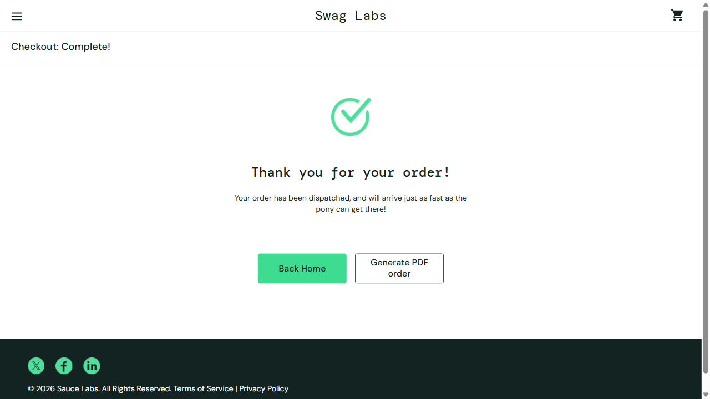

# E-Commerce Test Automation Framework


End-to-end UI test automation for an e-commerce application, built with **Playwright** and **TypeScript**. The suite automates the complete purchase journey, from login to downloading the order invoice.

## Table of Contents

- [Overview](#overview)
- [Workflow Covered](#workflow-covered)
- [Tech Stack](#tech-stack)
- [Key Features](#key-features)
- [Project Structure](#project-structure)
- [Getting Started](#getting-started)
- [Running the Tests](#running-the-tests)
- [Test Report](#test-report)
- [CI/CD](#cicd)
- [Author](#author)

## Overview

This project validates the core user flow of an e-commerce application through automated browser tests. It uses reusable fixtures, resilient locators, and assertions at each step to confirm the application behaves as expected.

## Application Under Test

[Sauce Demo](https://www.saucedemo.com/) is a public demo e-commerce site maintained by Sauce Labs for practicing test automation. It provides login, a product catalog, a shopping cart, and a checkout flow.

## Workflow Covered

```
Login → Home Page → Add Items to Cart → Checkout → Place Order → Download Order PDF
```

| Test File | Scenario |
|-----------|----------|
| `Ecommerce_Login.spec.ts` | Login with valid credentials (fixture) and invalid login |
| `Add_CartItem.spec.ts` | Add item to cart and continue shopping |
| `Checkout.spec.ts` | Checkout the listed items and place the order |
| `download.spec.ts` | Download the order PDF |

## Tech Stack

| Tool | Purpose |
|------|---------|
| [Playwright](https://playwright.dev/) | Browser automation and test runner |
| TypeScript | Strongly typed test code |
| Node.js | Runtime environment |
| GitHub Actions | Continuous integration |

## Key Features

- **Fixtures** for reusable login setup, keeping tests short and DRY
- **Playwright locators** for stable, readable element selection
- **Assertions** to verify the expected application state at every step
- **Download handling** to capture and validate the order PDF
- **Screenshots** to record test execution and results
- **HTML reports** for clear test results
- **CI integration** with GitHub Actions on every push

## Project Structure

```
Automation/
├── .github/workflows/     # GitHub Actions CI configuration
├── Automation_Testing/    # [Describe contents, e.g. page objects / fixtures]
├── tests/                 # Test specifications
├── playwright.config.ts   # Playwright configuration
├── package.json           # Dependencies and scripts
└── screenshot.png         # Sample test run screenshot
```

## Getting Started

### Prerequisites

- [Node.js](https://nodejs.org/) (v18 or later recommended)
- npm

### Installation

```bash
# Clone the repository
git clone https://github.com/Venkatesh26020/Automation.git
cd Automation

# Install dependencies
npm install

# Install Playwright browsers
npx playwright install
```

## Running the Tests

```bash
# Run all tests
npx playwright test

# Run a specific test file
npx playwright test tests/Ecommerce_Login.spec.ts

# Run in headed mode (visible browser)
npx playwright test --headed

# Run in UI mode
npx playwright test --ui

# Debug a test
npx playwright test --debug
```

## Test Report

After a run, open the HTML report:

```bash
npx playwright show-report
```



## CI/CD

Tests run automatically through **GitHub Actions** on every push. The workflow is defined in `.github/workflows/`.

## Author

**Venkatesh**
[GitHub](https://github.com/Venkatesh26020) | [LinkedIn]([www.linkedin.com/in/venkatesh-s-945953199])
